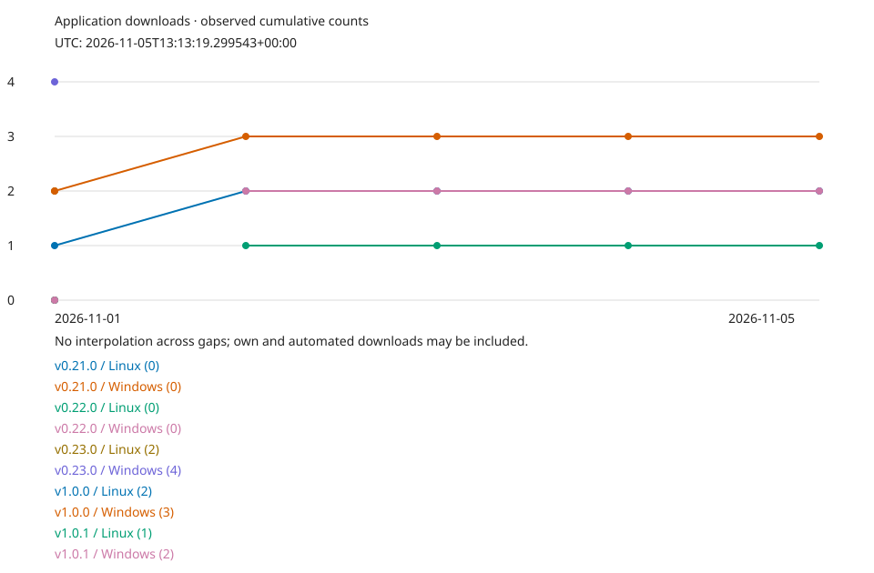

# AS release downloads

Last successful observation (UTC): **2026-11-09T13:54:58.613826+00:00**

## Current published stable application assets

| Release | Platform | Downloads | Asset ID |
| --- | --- | ---: | ---: |
| v1.0.0 | Linux | 2 | 655605119 |
| v1.0.0 | Windows | 3 | 655611108 |
| v1.0.1 | Linux | 1 | 698949991 |
| v1.0.1 | Windows | 2 | 698956820 |

Counts include own/repeated/automated downloads, not unique people or active users.
Only the two named application archives count; dependency sources, drafts and prereleases do not.
Totals cover currently present stable assets, not all historically deleted files.
The first successful sample per UTC day is retained. Missing days are not reconstructed.
On API failure the last successful dated report remains unchanged; check its date.

## Gaps and asset/counter changes

- 2026-11-02: Removed asset: v0.21.0 / AkihabaraiScore-windows.zip / id 484716003
- 2026-11-02: Removed asset: v0.21.0 / AkihabaraiScore-linux-x86_64.tar.gz / id 484717793
- 2026-11-02: Removed asset: v0.22.0 / AkihabaraiScore-linux-x86_64.tar.gz / id 489578154
- 2026-11-02: Removed asset: v0.22.0 / AkihabaraiScore-windows.zip / id 489579389
- 2026-11-02: Removed asset: v0.23.0 / AkihabaraiScore-linux-x86_64.tar.gz / id 496791970
- 2026-11-02: Removed asset: v0.23.0 / AkihabaraiScore-windows.zip / id 496793941
- 2026-11-02: New asset: v1.0.1 / AkihabaraiScore-linux-x86_64.tar.gz / id 698949991
- 2026-11-02: New asset: v1.0.1 / AkihabaraiScore-windows.zip / id 698956820
